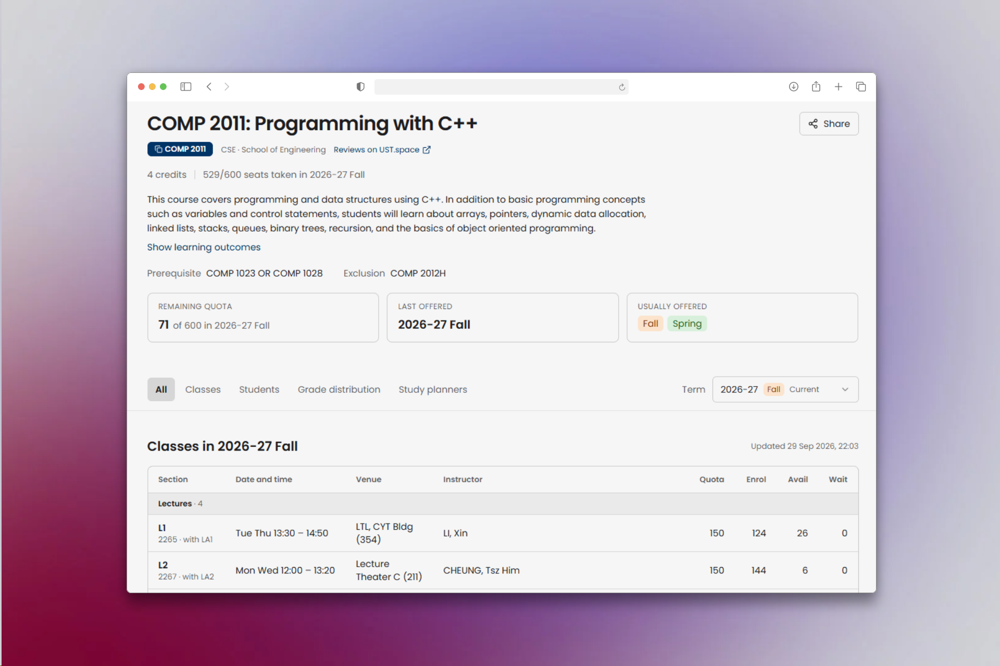

import courseSearchVideo from './vid/course-search.mp4';
import courseSearchPoster from './img/course-search-poster.png';

# Course Search and Course Pages

Use course search to find HKUST courses by code or title. Open a course page to explore its requirements, classes, seats, grade distribution, and connections to your study plans.

## Find a course

After you sign in, course search is available:

- At the top of the Dashboard home page.
- Above course pages on desktop.
- In the header on phones.
- Through a search dialog on desktop.

1. Select the search box.
2. Enter at least two characters from a course code or title, such as `COMP 2011` or `machine learning`.
3. Select a result to open its course page.

<video
  aria-label="Searching for machine learning and viewing matching courses"
  autoPlay
  muted
  loop
  controls
  playsInline
  preload="metadata"
  poster={courseSearchPoster}
  src={courseSearchVideo}
  style={{width: '100%', height: 'auto'}}
/>

### Keyboard shortcuts

On desktop, these shortcuts open the search dialog from any Dashboard page:

| Shortcut | Action |
| --- | --- |
| `/` | Open search while you are outside a text field |
| `⌘K` on Mac or `Ctrl+K` on Windows/Linux | Open or close search, including from a text field |
| `↑` / `↓` | Move between results |
| `Enter` | Open the highlighted result |
| `Esc` | Close search |

The search dialog does not open over another dialog. On phones, use the search box in the header.

## Course page features

- **Course overview:** View the description, credits, learning outcomes, requirements, and Common Core areas.
- **Offering information:** See remaining quota, the last offering, and the seasons in which the course usually runs.
- **Term selection:** Switch academic terms to view the corresponding course information, classes, and Timetable Plans.
- **Classes:** Compare section times, venues, instructors, quotas, enrollment, available seats, waitlists, and remarks.
- **Seats by term:** Compare enrollment and quota across academic terms in the **Students** tab.
- **Grade distribution:** View combined grade statistics for a term or all terms after you opt in to grade sharing.
- **Study planners:** Find related Graduation Plans, Semester Plans, and Timetable Plans.
- **Curricula:** Search and sort published curricula that include the course.

## Share a course

1. Select **Share** beside the course title.
2. Copy the course link, or select **Share link** to use your device’s sharing options.
